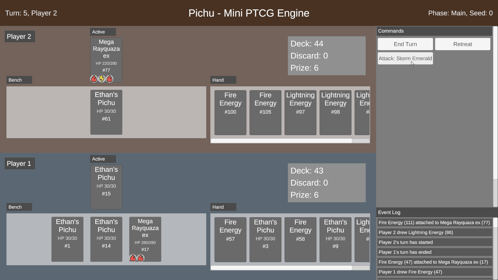
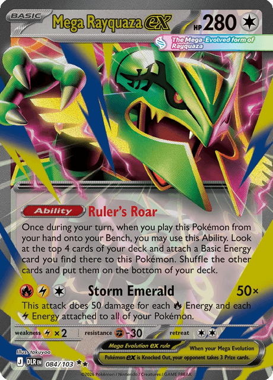
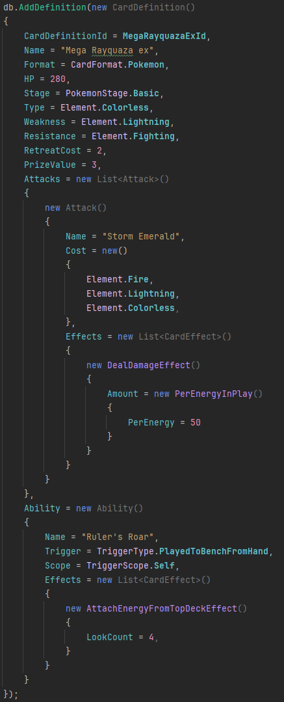
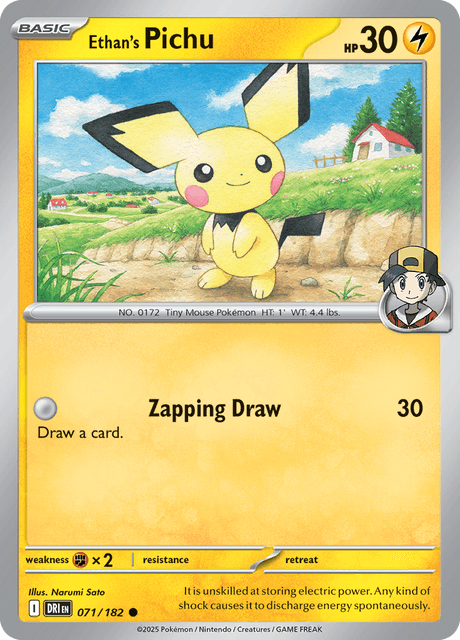
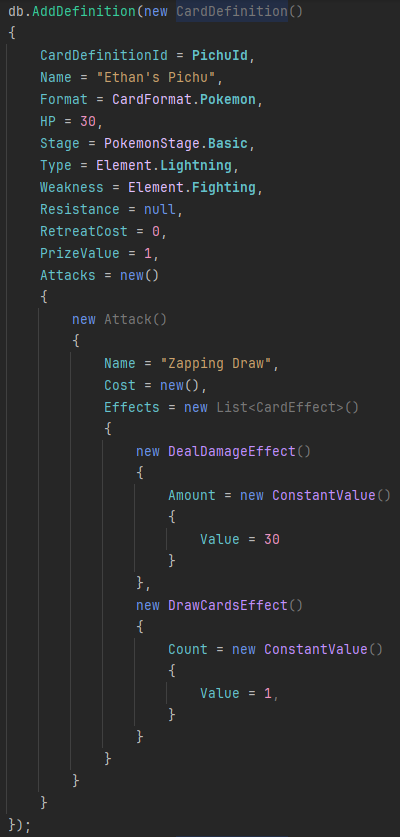
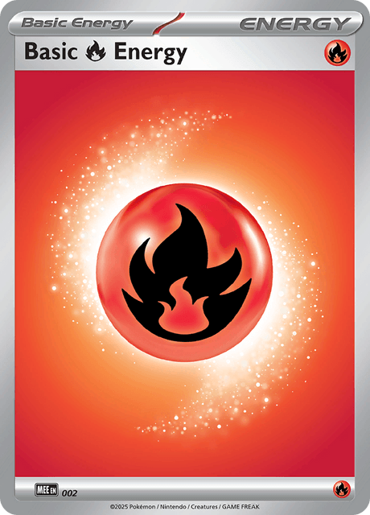
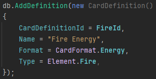
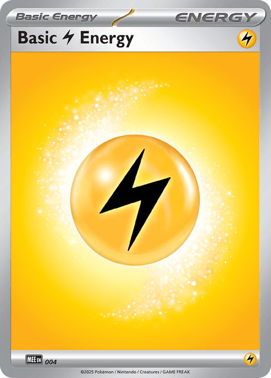
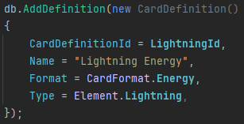
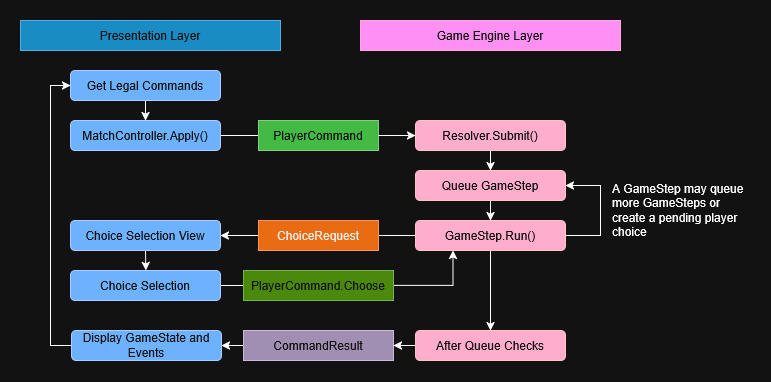

# Pichu
Pichu is a Pokemon trading card game engine, with a unity interface to display and interact with the game engine.

The current board state is displayed in the main left area. Legal commands and choices are shown as a list of buttons on the right. An event log is shown in the bottom right.

# Implemented Cards
Card are represented entirely by serializable data. Cards are initialized in `StarterCardSet.cs`
## Mega Rayquaza ex

  
  

## Ethan's Pichu

  
  

## Fire Energy

  
  

## Lightning Energy

  
  

# Architecture

1. The presentation layer and game engine layer are kept separate
	1. Each layer is kept in a separate assembly definition, the engine does *not* reference the presentation
	2. The player interaction with the game is solely through the unity presentation layer (PTCGPresentation)
	3. All of the game logic is on the engine layer (PTCGEngine)
	4. The presentation layer displays the engine's game state, game events, and provides input to the engine through `PlayerCommands`
2. Serializable board state
	1. The engine board state can be copied and serialized
	2. This allows a set of modifications to the board state to be performed on a copy, for action previewing or rolling back
3. Deterministic RNG
	1. Two games with the same seed will play out exactly the same given the same PlayerCommands are made, including: shuffles, draws, and coinflips
	2. All actions that require RNG run through a deterministic random number generator (`TinyRNG`)
	3. Types with non-deterministic operations such as `float` are avoid
4. PlayerCommand generation and shared validation
	1. All possible actions a player can take are generated, verified, and displayed to the player (`RuleChecker.GetLegalCommands`)
	2. The presentation layer uses the same `PlayerCommand` verification that the engine uses: `RuleChecker.Check()`
5. Queue based game loop (`Resolver.RunToCompletion()`)
	1. A `PlayerCommand` results in corresponding `GameStep`s being added to the step queue
	2. Each step in the queue is run
	3. Steps can recursively queue more steps, usually at the front of the queue
		1. ex: `AttackStep` queues  `EndTurnStep`
		2. This allows complicated steps to easily build off basic steps without a lot of duplicate code
6. Game state check ladder
	1. When the step queue is empty, a series of checks are run, each triggered check results in results in new `GameStep`s being queued and an early exit
	2. The main game loop doesn't end until all checks have passed
	3. The state checks for KO's, prize cards owed, win/loss conditions, and promotions when the active is empty
7. GameEvents as explanation of GameState changes
	1. GameState represents the current state of the game but GameEvents help explain how the state got there
	2. GameSteps generate GameEvents that describe the changes they are making to the game state
	3. ex: A new state has a new card in hand and the GameEvent list has a new entry with a CardDrawn event with the id of the card
8. Data driven card behavior
	1. `CardDefinition` holds all of the information about what a card is/does
	2. This includes the name of the card, whether it is Pokemon/item/energy/etc, their attacks, and ability
	3. Attacks and abilities have a collection of `CardEffect`, similar to `GameStep`, they are run in the game loop, apply changes to the `GameState`, and can queue `GameStep` to implement complicated behaviors by combining simpler steps
9. Information lookup hooks
	1. `CardQueries` contains a collection of static functions to get information about a card, rather than the using code directly looking up the information itself
	2. ex: Use `CardQueries.GetRetreatCost()` to lookup the retreat cost of a card, rather than checking the `CardInstance`'s `CardDefinition`
	3. This provides an easy way to override behavior in the future, for example: implementing a free retreat cost status effect

# Features
These are the game mechanics that Pichu supports:
1. Game setup: Shuffling, drawing hand, mulligans (redrawing hand and giving opponent free draw), choosing first active Pokemon
2. Drawing for turn
3. Benching basic Pokemon
4. One manual energy attachment per turn
5. One manual retreat per turn, with choice of energy to discard
6. Attacking, with effects
7. Damage counters and remaining HP tracking
8. Auto triggerable abilities
9. Ending turn
10. KO check, including drawing prize cards and choosing benched Pokemon to promote
11. Game over checks: deckout, no Pokemon remaining, no prize cards remaining

# AI Use
All code in this repository (except `SerializableDictionary.cs`) is written by me. Claude Code, running Opus 5.5, was used to create a project plan, answer questions, and review code.